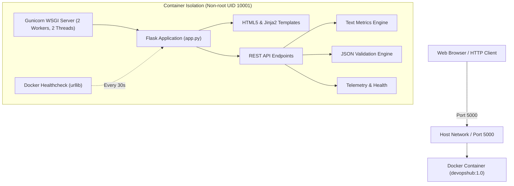

<<<<<<< HEAD
# DevOpsHub

> **Developer Tools. Simplified.**  
> *A Production-Grade Containerized Python Flask Web Application & REST API Engine*  
> **TechNova Cloud Computing Internship — Task 4: Docker Containerization**

[](https://www.python.org/)
[](https://flask.palletsprojects.com/)
[](https://www.docker.com/)
[](https://gunicorn.org/)
[](https://docs.pytest.org/)
[](https://getbootstrap.com/)

---

## 1. Project Overview

**DevOpsHub** is a modern, lightweight, developer utility platform and REST API service designed for software engineers and DevOps practitioners. Built with **Python 3.12**, **Flask**, and **Gunicorn**, DevOpsHub provides essential text transformation and JSON formatting/validation tools while serving as a blueprint for Docker containerization best practices.

This repository satisfies all requirements for **TechNova Cloud Computing Internship Task 4 (Docker Containerization)**, implementing:
- Clean modular application architecture with automated test coverage.
- Secure, non-root Docker container packaging with layer caching and health checking.
- Single-command container deployment via Docker Compose.
- Production-grade security headers, input validation, and request size limits.

---

## 2. Key Features

- **Developer Dashboard:** Overview of runtime statistics, host/container detection, and operational telemetry.
- **Text Processing Utility:**
  - Real-time word count, character count (with & without spaces), line count, and byte size calculation.
  - Case transformations (UPPERCASE, lowercase).
  - Redundant whitespace and blank-line cleaning.
  - One-click clipboard copying and workspace clearing.
  - Server-side analysis via `/api/text/analyze`.
- **JSON Formatter & Syntax Validator:**
  - Configurable indentation (2 or 4 spaces).
  - Deep syntax error diagnostics pinpointing line and column numbers.
  - JSON payload minification.
  - Sample valid and broken JSON payloads for interactive demonstrations.
  - One-click formatted JSON copying.
- **Live System & Health Monitoring:**
  - Real-time uptime tracking and UTC server timestamps.
  - Container environment detection evaluating `/.dockerenv` and `/proc/1/cgroup` markers without fabricated metrics.
- **Interactive REST API Documentation & Tester:**
  - Built-in GUI modal to execute live API calls against all endpoints.
  - Response status code, roundtrip latency, and formatted JSON output display.
- **Enterprise-Grade Containerization:**
  - Official `python:3.12-slim` base image.
  - Dedicated non-root user (`UID 10001 / appuser`).
  - Gunicorn WSGI multi-worker HTTP server.
  - Native Python urllib health check without requiring external utilities like `curl`.

---

## 3. Screenshots

> *Add your application screenshots to `static/images/` and reference them here.*

### Dashboard Overview
```markdown

```
*Overview section showcasing system specifications, Python runtime, and WSGI status.*

### Text Processing & JSON Validator
```markdown

```
*Interactive text utility and JSON syntax validator in action.*

### Interactive REST API Tester
```markdown

```
*Executing live API requests with latency and HTTP status code tracking.*

#### How to Capture and Add Real Screenshots:
1. Start the application locally or in Docker (`http://localhost:5000`).
2. Use **Windows Snipping Tool** (`Win + Shift + S`) to capture the dashboard sections.
3. Save the images into the `static/images/` directory with names matching the markdown tags above.
4. Commit and push the screenshots to GitHub.

---

## 4. Architecture Overview



---

## 5. Technology Stack

| Layer | Technology | Purpose |
|---|---|---|
| **Runtime** | Python 3.12 | Modern, secure Python interpreter |
| **Framework** | Flask 3.0.3 | Lightweight microframework for routing & REST APIs |
| **WSGI Server** | Gunicorn 22.0.0 | Production-grade WSGI HTTP server |
| **Testing** | Pytest 8.2.2 | Automated unit and integration test suite |
| **Container Engine** | Docker Engine & Compose | Container packaging and orchestration |
| **Base Image** | `python:3.12-slim` | Debian-based slim image with minimal footprint |
| **Frontend UI** | HTML5, Vanilla CSS3, Bootstrap 5.3 | Responsive dark navy SaaS design system |
| **Typography & Icons** | Inter, JetBrains Mono, Bootstrap Icons | Developer-centric styling and visual clarity |

---

## 6. Project Folder Structure

```text
DevOpsHub/
├── app.py                  # Main Flask application, routes, APIs, and error handlers
├── requirements.txt        # Pinned production and testing dependencies
├── Dockerfile              # Multi-layer, secure, non-root container definition
├── compose.yaml            # Docker Compose orchestration configuration
├── .dockerignore           # Exclusions for Docker build context
├── .gitignore              # Exclusions for Git version control
├── README.md               # Complete project documentation & guide
├── templates/
│   └── index.html          # Semantic HTML5 dashboard template
├── static/
│   ├── css/
│   │   └── style.css       # Custom dark navy CSS design system
│   ├── js/
│   │   └── app.js          # Client-side reactivity, validation, and API fetch
│   └── images/             # Visual assets and project screenshots
└── tests/
    └── test_app.py         # Automated Pytest suite (15 unit/API tests)
```

---

## 7. Prerequisites

Before running the application, ensure the following are installed on your machine:

1. **Python 3.12+** (Verify with `python --version`)
2. **Git** (Verify with `git --version`)
3. **Docker Desktop for Windows** (Ensure Docker Engine is running; verify with `docker --version`)

---

## 8. Local Installation Instructions (Windows PowerShell)

Follow these steps to run DevOpsHub directly on Windows using PowerShell:

### Step 1: Open PowerShell and Navigate to the Project Directory
```powershell
cd C:\Users\Ketan\.gemini\antigravity-ide\scratch\DevOpsHub
```
*What it does:* Changes the working directory to the project root.

### Step 2: Create a Virtual Environment
```powershell
python -m venv venv
```
*What it does:* Creates an isolated Python virtual environment named `venv`.

### Step 3: Activate the Virtual Environment
```powershell
.\venv\Scripts\Activate.ps1
```
*What it does:* Activates the isolated environment so dependencies do not conflict with system packages.  
*(Note: If PowerShell execution policy restricts scripts, run `Set-ExecutionPolicy -Scope Process -ExecutionPolicy Bypass` first).*

### Step 4: Install Dependencies
```powershell
pip install -r requirements.txt
```
*What it does:* Installs Flask, Gunicorn, and Pytest.

### Step 5: Start the Flask Application
```powershell
python app.py
```
*What it does:* Starts the Flask development server on `http://127.0.0.1:5000`.

Open your browser and visit: **`http://localhost:5000`**

---

## 9. Instructions to Run Tests

DevOpsHub includes 15 automated test cases validating HTTP status codes, JSON validation, string metrics, error handlers, and security headers.

### Run tests with Pytest:
```powershell
python -m pytest
```

### Run tests with detailed verbose output:
```powershell
python -m pytest -v
```

### Expected Output:
```text
tests/test_app.py::test_home_page_status_and_content PASSED              [  6%]
tests/test_app.py::test_api_health_endpoint PASSED                       [ 13%]
tests/test_app.py::test_api_info_endpoint PASSED                         [ 20%]
tests/test_app.py::test_text_analyze_valid_string PASSED                 [ 26%]
tests/test_app.py::test_text_analyze_empty_string PASSED                 [ 33%]
tests/test_app.py::test_text_analyze_missing_field PASSED                [ 40%]
tests/test_app.py::test_text_analyze_non_string_type PASSED              [ 46%]
tests/test_app.py::test_text_analyze_non_json_content_type PASSED        [ 53%]
tests/test_app.py::test_json_validate_valid_object PASSED                [ 60%]
tests/test_app.py::test_json_validate_invalid_syntax PASSED              [ 66%]
tests/test_app.py::test_json_validate_empty_string PASSED                [ 73%]
tests/test_app.py::test_json_validate_raw_payload PASSED                 [ 80%]
tests/test_app.py::test_nonexistent_api_route_returns_404_json PASSED    [ 86%]
tests/test_app.py::test_method_not_allowed_returns_405_json PASSED       [ 93%]
tests/test_app.py::test_security_headers_present PASSED                  [100%]

============================= 15 passed in 0.94s ==============================
```

---

## 10. Docker Installation & Build Instructions

Ensure **Docker Desktop** is running on your system.

### Build the Docker Image:
```powershell
docker build -t devopshub:1.0 .
```
*What it does:*
- Pulls `python:3.12-slim`.
- Configures environment variables (`PYTHONUNBUFFERED=1`, `PYTHONDONTWRITEBYTECODE=1`).
- Sets up non-root user `appuser` (UID 10001).
- Copies `requirements.txt` and installs dependencies.
- Copies application source code with non-root ownership.
- Exposes port 5000.
- Tags the image as `devopshub:1.0`.

### Verify Image Build:
```powershell
docker images | Select-String "devopshub"
```

---

## 11. Docker Run Instructions

### Run the Container in Standalone Mode:
```powershell
docker run --rm -p 5000:5000 --name devopshub_test devopshub:1.0
```

### Run Detached in Background:
```powershell
docker run -d -p 5000:5000 --name devopshub_app devopshub:1.0
```

*What it does:*
- `-d`: Runs container in detached background mode.
- `-p 5000:5000`: Forwards port 5000 on your host Windows machine to port 5000 inside the container.
- `--name devopshub_app`: Assigns a readable container name.

### Check Container Logs:
```powershell
docker logs devopshub_app
```

### Check Container Health Status:
```powershell
docker ps
```
*(Look for `(healthy)` under the STATUS column).*

### Stop and Remove the Container:
```powershell
docker stop devopshub_app
docker rm devopshub_app
```

---

## 12. Docker Compose Instructions

Docker Compose provides reproducible, single-command orchestration.

### Start the Application:
```powershell
docker compose up --build -d
```
*What it does:* Builds the image (if not already built) and starts the container in the background.

### Verify Service Status:
```powershell
docker compose ps
```
*What it does:* Lists running compose services, port mappings, and health status.

### View Real-time Service Logs:
```powershell
docker compose logs -f
```
*What it does:* Follows standard Gunicorn access and application logs.

### Stop and Clean Up:
```powershell
docker compose down
```
*What it does:* Gracefully stops the container and removes networks.

---

## 13. Browser Testing Instructions

1. Open any web browser (Google Chrome, Microsoft Edge, Mozilla Firefox).
2. Navigate to: **`http://localhost:5000`**
3. Verify the following:
   - **Status Badge:** Confirms "Backend Active" with green indicator.
   - **System Specs:** Displays Python version, platform, and deployment mode.
   - **Text Utility:** Enter text, test UPPERCASE, lowercase, extra whitespace removal, and copy to clipboard.
   - **JSON Utility:** Click **Load Valid Sample**, then click **Format & Validate**. Then click **Load Broken Sample** and observe the line/column syntax error message.
   - **REST API:** Click **Test Endpoint** on any route in the REST API section to launch the interactive modal and verify live JSON responses.

---

## 14. REST API Endpoint Documentation

All API responses are formatted in JSON and include appropriate HTTP status codes.

### 1. Health Check
- **Route:** `GET /api/health`
- **Description:** Verifies service liveness, uptime, and server time.
- **Sample Request:**
  ```powershell
  Invoke-RestMethod -Uri "http://localhost:5000/api/health" -Method Get
  ```
- **Sample Response (HTTP 200 OK):**
  ```json
  {
    "service": "DevOpsHub",
    "status": "healthy",
    "timestamp": "2026-10-19T16:15:20.123456+00:00",
    "uptime_seconds": 128,
    "version": "1.0.0"
  }
  ```

---

### 2. Application Information
- **Route:** `GET /api/info`
- **Description:** Returns application specs, runtime configuration, and available endpoints.
- **Sample Request:**
  ```powershell
  Invoke-RestMethod -Uri "http://localhost:5000/api/info" -Method Get
  ```
- **Sample Response (HTTP 200 OK):**
  ```json
  {
    "app_name": "DevOpsHub",
    "containerized": true,
    "deployment_environment": "Docker Container (Linux)",
    "python_version": "3.12.3",
    "version": "1.0.0",
    "wsgi_server": "Gunicorn",
    "available_endpoints": [
      { "endpoint": "/", "method": "GET", "description": "DevOpsHub Web Dashboard" },
      { "endpoint": "/api/health", "method": "GET", "description": "Application health check and uptime" },
      { "endpoint": "/api/info", "method": "GET", "description": "Application metadata and runtime info" },
      { "endpoint": "/api/text/analyze", "method": "POST", "description": "Calculate text metrics (words, chars, lines)" },
      { "endpoint": "/api/json/validate", "method": "POST", "description": "Validate and format JSON payloads" }
    ]
  }
  ```

---

### 3. Text Analysis
- **Route:** `POST /api/text/analyze`
- **Headers:** `Content-Type: application/json`
- **Payload:** `{"text": "DevOpsHub containerized with Docker."}`
- **Sample Request:**
  ```powershell
  $body = @{ text = "DevOpsHub containerized with Docker." } | ConvertTo-Json
  Invoke-RestMethod -Uri "http://localhost:5000/api/text/analyze" -Method Post -Body $body -ContentType "application/json"
  ```
- **Sample Response (HTTP 200 OK):**
  ```json
  {
    "metrics": {
      "byte_size": 38,
      "character_count": 38,
      "character_count_no_spaces": 34,
      "line_count": 1,
      "paragraph_count": 1,
      "word_count": 4
    },
    "success": true
  }
  ```

---

### 4. JSON Syntax Validator
- **Route:** `POST /api/json/validate`
- **Headers:** `Content-Type: application/json`
- **Payload:** `{"json_string": "{\"app\": \"DevOpsHub\"}", "indent": 2}`
- **Sample Request:**
  ```powershell
  $body = @{ json_string = '{"app": "DevOpsHub"}'; indent = 2 } | ConvertTo-Json
  Invoke-RestMethod -Uri "http://localhost:5000/api/json/validate" -Method Post -Body $body -ContentType "application/json"
  ```
- **Sample Response (HTTP 200 OK):**
  ```json
  {
    "formatted": "{\n  \"app\": \"DevOpsHub\"\n}",
    "item_count": 1,
    "size_bytes": 26,
    "type": "dict",
    "valid": true
  }
  ```
- **Sample Error Response for Broken JSON (HTTP 400 Bad Request):**
  ```json
  {
    "char_pos": 18,
    "column": 3,
    "error": "Expecting ',' delimiter",
    "line": 3,
    "message": "Syntax error at line 3, column 3: Expecting ',' delimiter",
    "valid": false
  }
  ```

---

## 15. Troubleshooting

| Issue | Root Cause | Solution |
|---|---|---|
| `docker: failed to connect to the docker API` | Docker Desktop daemon is not running | Launch Docker Desktop from the Start menu and wait until the whale icon shows "Engine running". |
| `File Activate.ps1 cannot be loaded because running scripts is disabled` | PowerShell execution policy restrictions | Run `Set-ExecutionPolicy -Scope Process -ExecutionPolicy Bypass` in the current terminal session, then re-run `.\venv\Scripts\Activate.ps1`. |
| `Bind for 0.0.0.0:5000 failed: port is already allocated` | Another local process or container is using port 5000 | Find and kill the conflicting process: `Get-NetTCPConnection -LocalPort 5000` or change host port in `compose.yaml` to `5001:5000`. |
| `413 Request Entity Too Large` | Payload exceeds 2MB limit | Ensure uploaded payloads do not exceed `app.config["MAX_CONTENT_LENGTH"] = 2MB`. |

---

## 16. GitHub Publishing Instructions

To publish your project to GitHub under the recommended repository name **`TechNova_DevOpsHub`**:

1. **Initialize Git Repository (if not already initialized):**
   ```powershell
   git init
   ```

2. **Stage and Commit Project Files:**
   ```powershell
   git add .
   git commit -m "feat: complete DevOpsHub containerized Flask project for TechNova Task 4"
   ```

3. **Rename Branch to `main`:**
   ```powershell
   git branch -M main
   ```

4. **Create a New Repository on GitHub:**
   - Go to [github.com/new](https://github.com/new).
   - Set the repository name to: **`TechNova_DevOpsHub`**.
   - Set visibility to **Public** (or Private, per internship guidelines).
   - Do **NOT** initialize with a README, .gitignore, or license (these already exist locally).

5. **Link Remote and Push:**
   ```powershell
   git remote add origin https://github.com/YOUR_GITHUB_USERNAME/TechNova_DevOpsHub.git
   git push -u origin main
   ```
   *(Replace `YOUR_GITHUB_USERNAME` with your actual GitHub username).*

---

## 17. Optional Docker Hub Publishing Instructions

To distribute your pre-built image via Docker Hub:

1. **Log in to Docker Hub:**
   ```powershell
   docker login
   ```

2. **Tag the Image with Your Docker Hub Namespace:**
   ```powershell
   docker tag devopshub:1.0 YOUR_DOCKERHUB_USERNAME/devopshub:1.0
   docker tag devopshub:1.0 YOUR_DOCKERHUB_USERNAME/devopshub:latest
   ```
   *(Replace `YOUR_DOCKERHUB_USERNAME` with your Docker Hub handle).*

3. **Push to Docker Hub:**
   ```powershell
   docker push YOUR_DOCKERHUB_USERNAME/devopshub:1.0
   docker push YOUR_DOCKERHUB_USERNAME/devopshub:latest
   ```

4. **Pull and Run from Anywhere:**
   ```powershell
   docker run --rm -p 5000:5000 YOUR_DOCKERHUB_USERNAME/devopshub:1.0
   ```

---

## 18. Learning Outcomes

Through completing this project, the following cloud computing and DevOps competencies were demonstrated:
- **Web Application Architecture:** Structuring production-minded Flask backends with separated presentation, business logic, and API handlers.
- **API Design & Validation:** Designing RESTful endpoints with input validation, graceful error handling, and security headers.
- **Containerization Best Practices:** Writing secure, efficient Dockerfiles using minimal base images, multi-layer caching, non-root user execution, and health checks.
- **Orchestration with Compose:** Defining declarative multi-container specifications for local development and testing.
- **Automated Testing:** Implementing unit and API integration testing using Pytest and Flask test clients.
- **Documentation Standards:** Producing clear, comprehensive technical documentation for peer developers and DevOps teams.

---

## 19. Acknowledgement

This project was developed for the **TechNova Cloud Computing Internship — Task 4: Docker Containerization**.

*Special thanks to the TechNova mentors and team for the project guidelines and technical curriculum.*
=======
# TechNova_DevOpsHub
>>>>>>> e383fca6f392be057a8059eff21e3187e216725c
